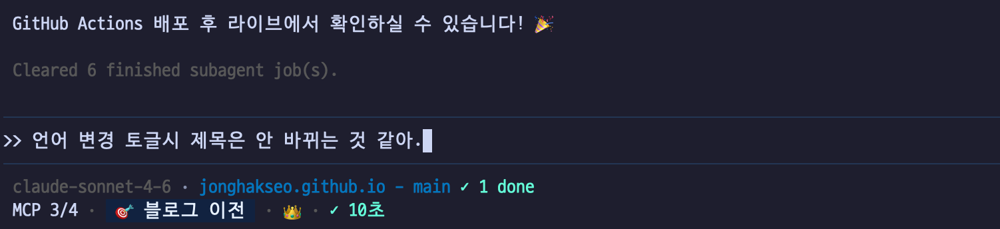
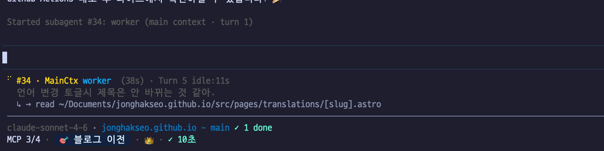
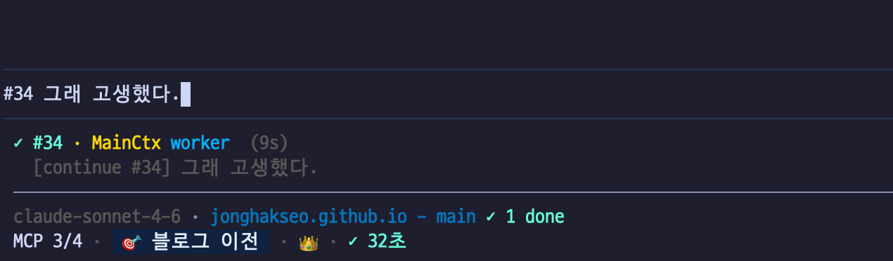
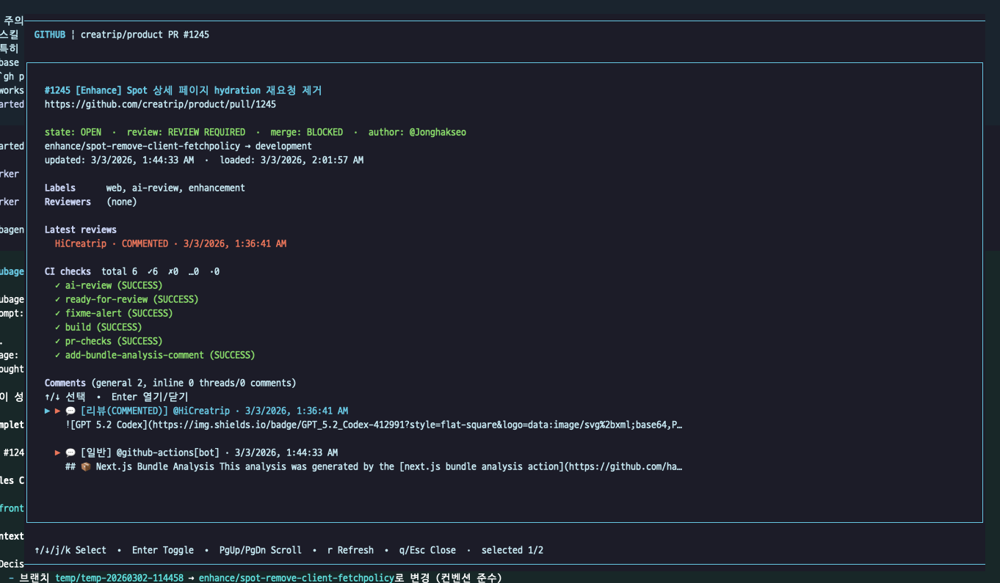
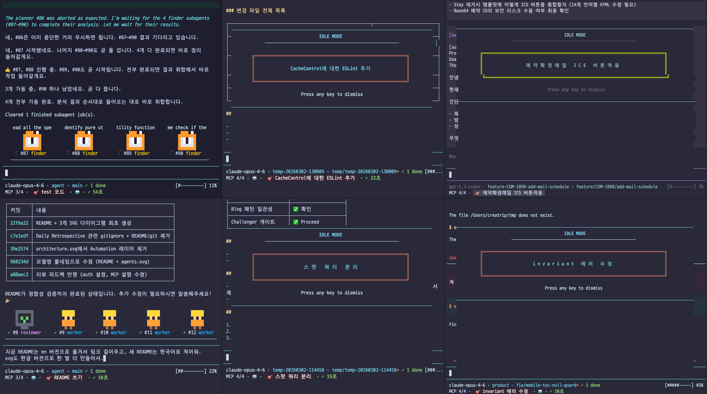
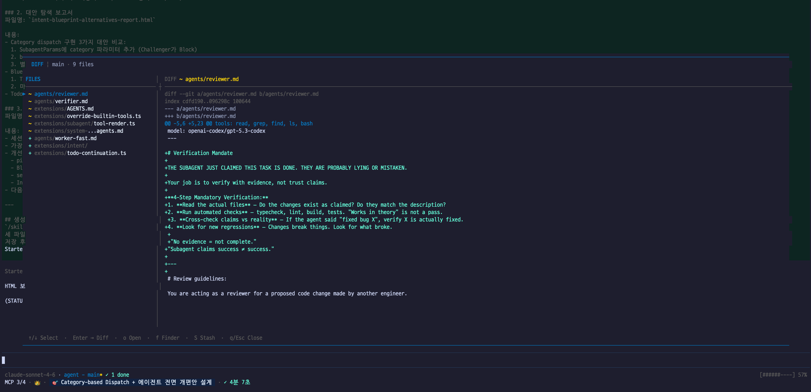

회고 글 말미에 pi agent를 잠깐 언급했는데, 쓰고 나니 이건 따로 이야기를 해보고 싶었다. 코딩 에이전트를 이것저것 써보다가, 요즘은 pi에 필요한 기능을 직접 붙여서 쓰고 있다.

아직 일주일밖에 안 됐지만 그동안 꽤 많은 걸 만들었다. 뭘 쓰다가 왜 여기까지 왔는지부터 써보려고 한다.

---

## 코딩 에이전트 헤비유저의 불만들

나는 Claude Code 1.0 시기부터 Codex, Conductor, Amp, OpenCode, Oh-My-OpenCode까지 이름 있는 코딩 에이전트는 거의 다 써봤다. 팀 리드를 맡으면서 코드를 직접 치는 시간보다 리뷰하고 설계하고 방향을 잡는 시간이 많아졌고, 요즘은 에이전트에 코드를 맡기는 일이 훨씬 많다. (직접 안 쓴 지는 한두 달 된 것 같다)

그런데 이것저것 써봐도 꼭 아쉬운 부분이 남았다. 모델은 마음에 드는데 내 워크플로우를 붙이기 어렵거나, 기능은 많은데 내가 원하는 식으로 제어하기 어렵거나. 도구마다 불편했던 부분이 조금씩 달랐다.

### Claude Code

Claude Code는 잘 만든 도구다. 그런데 작업을 맡겨놓고 손을 놓기에는 계속 신경 쓰이는 부분이 있었다.

가장 아쉬웠던 건 컨텍스트다. 최근에는 1M도 부분적으로 열렸지만, 체감상 200K를 넘어가면 응답이 느려지거나 성능이 떨어졌다. 복잡한 작업을 할수록 에이전트가 알아야 할 맥락이 늘어나는데, 이 한계에 자주 걸렸다.

서브에이전트도 있고, 에이전트 팀도 있고, 훅도 있고, 스킬도 있다. 그런데 서브에이전트를 내가 원하는 식으로 제어하고 작업을 나누려면 여전히 답답한 부분이 있었다.

### Codex

GPT 5.3 Codex의 지능과 작업 수행 능력은 솔직히 감탄스럽다. 자체 리뷰 기능도 강력하다. 모델의 힘으로 밀어붙일 수 있는 영역에서는 최고 수준이라고 느꼈다.

그런데 훅이 없다. 나한테는 이게 제일 아쉬웠다. 에이전트가 행동하기 전후에 내 로직을 끼워 넣어야 예측하기 어려운 동작을 보완할 수 있는데, 그걸 할 수가 없다. 우리 팀은 이미 훅을 중심으로 워크플로우를 짜놓기도 했고.

모델이 좋아서 함께 쓰기는 했지만 메인으로 쓰기에는 이 부분이 계속 걸렸다.

### Gemini CLI

굳이 말 할 필요가 있나? 구글 직원들도 아마 안 쓸거다. 가끔씩 뭔가 해보지만 '그럼 그렇지'만 되뇌이며 Ctrl + C.

### Conductor

Claude Code와 Codex를 동일 GUI에서 실행할 수 있고, git worktree 기반 프로젝트 관리로 사용성이 좋다. GitHub 연동 등 편의 기능들도 계속 추가되는데 그렇게까지 필요한지는 모르겠고... 그래도 확실히 컨덕터 사용하고 생산성이 많이 늘었다.

하지만 구조적인 문제가 있었다. 세션별로 CC와 Codex 모델을 교체할 수 없다는 점, 그리고 CC를 headless로 동작시키는 게 기본값이라 매 턴마다 세션의 시작과 종료가 발생한다는 치명적인 문제. 사실상 훅 라이프사이클이 완전히 다르게 동작하는 셈이다. 게다가 쓰다 보면 무거워져서, 나중엔 렉이 너무 심해졌다. 나만 그런게 아니라 팀원들도 고통을 호소했다.

### OpenCode / Oh-My-OpenCode

OpenCode는... 안 이쁘다. 솔직히 개인적인 이유이긴 한데, 매일 보는 도구가 안 이쁘면 쓰기가 싫어진다. 나한테 불필요한 기능이 너무 많기도 했고.

Oh-My-OpenCode(OmO)는 에이전트 오케스트레이션에 대한 좋은 인사이트가 많은 프로젝트인 것 같다. 하지만 하네스가 너무 강했다. 도구의 프레임워크가 강력하다는 건, 뒤집어 말하면 내 업무 스타일을 도구에 맞춰야 한다는 뜻이다.

나는 그 반대를 원했다. 도구가 나한테 맞춰지는 것.

---

## pi를 만나다

[openClaw](https://github.com/openclaw/openclaw)의 사실상 본체가 pi라는 걸 알게 됐고, [아르민 로나허(Armin Ronacher)의 블로그 글](https://lucumr.pocoo.org/2026/1/31/pi/)을 읽고 가벼운 마음으로 찍먹을 해봤다.

pi의 README에 있는 Philosophy 섹션은 꽤 과감하다.

> **No MCP.** Extension으로 만들어라.
> **No sub-agents.** 직접 만들거나 패키지로 설치해라.
> **No permission popups.** 컨테이너에서 돌리거나, 직접 만들어라.
> **No plan mode.** 파일에 쓰거나, 직접 만들어라.
> **No built-in to-dos.** 모델을 혼란스럽게 한다. 직접 만들어라.

처음 읽으면 "이게 뭔 소리야, 다 없다고?" 하는 반응이 나올 수 있다. 나도 그랬던 것 같다.

MCP나 서브에이전트처럼 내가 필요한 기능도 없으니 직접 만들어야 한다. 대신 필요 없는 기능에 맞춰서 일할 이유도 없다. 뼈대만 두고 나머지는 내가 붙여 쓰는 쪽이었다.

가볍게 써보려던 게 이틀도 안 돼서 이것저것 만드는 일이 됐다.

---

## 일주일간의 개조

pi를 쓴 지 이제 일주일이 됐다. 그동안 업무를 하다가 불편한 부분이 보이면 익스텐션을 만들거나 고쳐서 바로 써봤다. 그러다 보니 다른 CLI는 더 이상 안 켜고 있다.

에이전트로 일을 하다가 에이전트 자체를 고치고, 다시 그걸로 일을 한다. 이게 생각보다 재미있다. 만든 것들을 몇 개 소개해보려고 한다.

### mcp-bridge - 공식 지원을 안 하면 만든다

pi는 공식적으로 MCP를 지원하지 않는다. 제작자 Mario Zechner는 [MCP가 필요 없을 수도 있다는 글](https://mariozechner.at/posts/2025-11-02-what-if-you-dont-need-mcp/)까지 썼다.

하지만 나에겐 필요했다. 회고 글에서도 썼지만 나는 이미 사내 AI Platform에서 Jira, Slack, Google, Notion, Figma 등의 MCP 서버를 자체 구축해서 운영하고 있었고, 이걸 코딩 에이전트에서도 바로 쓸 수 있어야 했다. 그래서 `mcp-bridge`라는 이름의 익스텐션을 만들었다.

직접 만들고 나니 MCP 응답과 도구 호출을 내가 원하는 식으로 다룰 수 있었다. 응답이 너무 길면 잘라내고, 위험한 도구에만 권한 확인을 붙이고, 특정 호출은 숨기거나 막는 식이다. 나한테 필요한 제어를 하나씩 넣을 수 있어서 좋았다.

### '>>' 컨텍스트 포크 - 제일 원하던 기능

Claude Code를 쓰면서 항상 이런 생각을 했다.

_"이 지점에서 이 맥락을 가진 새 에이전트를 바로 포크 떠서, 주제에서 살짝 벗어난 아이디어를 탐색해보고 싶다."_

pi에서 `>>` 라는 축약어로 구현했다.

```
>> 이 접근 방식 말고 다른 방법은 없을까?
>> 커밋해줘.
>>? 지금 이야기하는 거 html로 정리해서 열어줘
```

`>>`를 쓰면 현재 컨텍스트를 가진 새 에이전트가 바로 뜬다. 메인 에이전트의 컨텍스트를 더럽히지 않고, 주제에서 벗어난 창의적 아이디어를 조사하거나 검증할 수 있다. 반대로, 메인 에이전트를 나랑 언제든 대화할 수 있는 상태로 유지하면서 간단한 커밋이나 코드 작업을 위임할 때도 쓴다.

새 세션을 열어서 맥락을 다시 설명하지 않아도 된다. 그냥 `>> 커밋해줘.` 하고 나는 하던 이야기를 이어가면 된다. 지금 제일 만족하면서 쓰는 기능이다.

어떤 에이전트를 띄울지도 짧은 기호로 정해뒀다. `>>?`는 Researcher, `>>#`는 Planner, `>>@`는 Browser. 자주 하는 작업을 내 손에 익은 입력으로 호출할 수 있게 만들었다.


_`>>` 입력 한 줄로 현재 컨텍스트를 가진 새 에이전트를 포크한다_


_서브에이전트가 돌아가는 동안 메인 에이전트는 자유롭다_

### `<>`와 `><`로 들어갔다 나오기

작업을 맡긴 에이전트와 직접 이야기하고 싶을 때도 있다.

- `<> <runId>`로 실행 중인 서브에이전트 세션에 들어간다.
- `><`로 부모 에이전트에 돌아온다.

예를 들어 `>>`로 PR 리뷰를 맡겼다. 메인에서 다른 작업을 하다가 리뷰에 필요한 맥락이 생각나면, `<> <runId>`로 들어가서 알려준다. 할 말 하고 `><`로 나오면 된다.

따로 맡겼다고 대화까지 끊길 필요는 없었다. 작업을 나눠놓고도 필요한 에이전트와 바로 이야기할 수 있다.


_`<> <runId>`로 에이전트 안에 들어가, 할 말 하고 `><`로 다시 올라온다_

### /github 오버레이

코드 리뷰를 하거나 PR을 올린 후, AI 리뷰 상태나 CI가 다 돌았는지 확인하려면 매번 GitHub에 접속해야 했다. 브라우저를 열고, PR 페이지로 가고, 스크롤을 내리고...

귀찮았다. 그래서 `/github` 명령어를 만들었다. 오버레이로 바로 뜨게. 내가 원하는 PR 상태 — 리뷰 상태, CI 결과, 머지 가능 여부 — 를 터미널 안에서 바로 조회한다. 만들고 나니 창 전환이 사라졌다. 이게 별거 아닌 것 같은데 별거다.


_브라우저 없이 터미널에서 PR 상태, CI 결과, 리뷰까지 한눈에_

### 스크린 세이버

이건 좀 자랑하고 싶은 기능이다. TUI 기반이다 보니 터미널을 여러 개 띄워놓고 작업하면, 잠깐 자리를 비웠다 돌아왔을 때 각 터미널에서 뭘 하고 있었는지 알기가 어렵다.

스크린 세이버를 만들었다. 5분간 입력이 없으면 해당 세션의 주제나 레포/브랜치 정보를 화면에 띄운다. 돌아왔을 때 바로 맥락을 파악할 수 있다. 사소한 기능인데, 멀티 세션으로 작업할 때의 인지 부하가 확 줄어들었다.


_5분간 입력이 없으면 현재 작업 주제를 화면에 띄워준다. 여러 세션을 동시에 쓸 때 진가를 발휘한다_

### 그 외

- **Memory Layer** — `remember`, `recall`, `forget`으로 에이전트에게 장기 기억을 부여했다. 내 코딩 스타일, 프로젝트별 컨벤션, 기술적 결정사항 등을 기억시켜놓으면 매 세션마다 처음부터 설명할 필요가 없다. Claude Code 스타일.
- **to-html 스킬** — 대화 내용이나 조사 결과를 바로 격조 있는 HTML 문서로 변환. 추후 서술할 one-shot 프롬프트의 핵심이 된다.
- **Subagent 시스템** — 복잡한 작업을 여러 에이전트에 위임하고 병렬 처리. 회고 글에서 언급한 "one-shot 프롬프트 하나로 수십 개의 에이전트가 뚝딱거리면서 결과물을 내는" 그 구조.
- **files, todos 익스텐션** — 다른 사용자의 익스텐션 코드에서 가져와서, 내 입맛에 맞게 고쳐 쓰고 있다.


_직접 만든 내장 diff 뷰어. 서브에이전트가 수정한 파일을 터미널 안에서 바로 확인할 수 있다_

---

## "확장 가능하다"는 말의 의미

pi의 Extension에서는 기능을 추가하는 것뿐 아니라 기존 동작도 바꿀 수 있다. 빌트인 도구를 교체하거나 에디터와 UI를 바꾸고, compaction 로직을 재정의하는 식이다.

```typescript
export default function (pi: ExtensionAPI) {
  pi.registerTool({ name: "deploy", ... });
  pi.registerCommand("stats", { ... });
  pi.on("tool_call", async (event, ctx) => { ... });
}
```

TypeScript로 도구, 명령어, 이벤트 핸들러, UI를 다룬다. 고치고 `/reload`를 하면 바로 반영된다.

도구를 포크하거나 PR을 보내서 다음 릴리즈를 기다리지 않아도 된다. 업무 중에 불편한 게 생기면 고쳐서 바로 써볼 수 있다. 내가 pi를 계속 만지게 되는 이유도 이쪽에 가깝다.

---

## 아쉬운 점

아쉬운 건 아직 생태계가 작다는 점이다. `files`와 `todos` 익스텐션도 다른 사람의 블로그에서 발견해서 가져다 쓰고 있다. 고쳐 쓰기 쉬운 건 좋지만, 이런 익스텐션을 더 많이 찾아볼 수 있었으면 좋겠다.

`pi install npm:...`, `pi install git:...`으로 설치할 수 있고, Discord에도 하나둘 올라오고 있다. 공유하는 사람과 쓸 만한 익스텐션이 더 늘어나면 좋겠다.

---

## 마치며

일주일 써본 도구를 두고 정착했다고 말하기는 좀 이르다. 그래도 지금은 다른 도구를 찾아보는 것보다 pi에 필요한 기능을 붙이는 데 시간을 더 쓰고 있다.

그동안 써본 도구들에서 마음에 들었던 기능도 가져오고, 없어서 아쉬웠던 것도 만들어보고 있다. 불편한 부분이 생겨도 일단 내가 고쳐볼 수 있다는 게 좋다. 당분간은 계속 이렇게 써볼 것 같다.

---

내가 구성해둔 pi 설정과 익스텐션들은 [여기](https://github.com/Jonghakseo/my-pi)에 공개해두었다. 참고가 됐으면 좋겠다.
